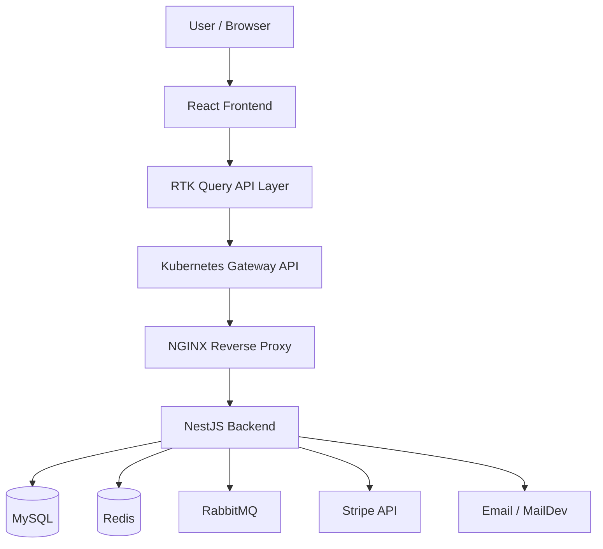
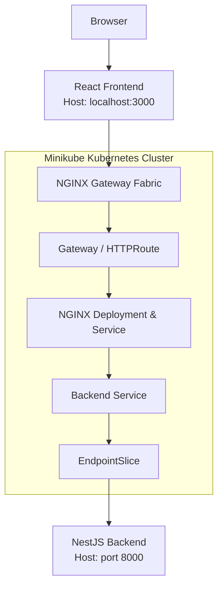

<h1 style="text-align: center;">🎟️ Ticketify</h1>

### Full-Stack Transportation & Ticket Booking Platform

A hands-on full-stack project combining **React**, **NestJS**, and
**Kubernetes networking**.

[Overview](#-overview) · [Features](#-key-features) ·
[Stack](#-technology-stack) · [Architecture](#-architecture) ·
[Infrastructure](#-infrastructure--networking) ·
[Setup](#-getting-started) · [Roadmap](#-development-roadmap)
:::📌 Overview
Ticketify is a transportation and ticket booking application built
with React, TypeScript, and NestJS.

The project combines application development with practical
infrastructure engineering. Alongside the frontend and backend, it
explores containerized dependencies, Kubernetes networking, NGINX
reverse proxying, and the Kubernetes Gateway API.

Ticketify is currently developed as a modular monolith. The backend
remains a single NestJS application, while its business modules and
integration patterns are being developed with clear boundaries in mind.
Current deployment status: React and NestJS run locally on the
development machine. NGINX and the Gateway API infrastructure run in a
local Minikube cluster. The application frontend and backend have not
yet been deployed as Kubernetes workloads.

✨ Key Features
Application
- React-based user interface.
- Client-side routing and shared state management.
- API communication and caching with Redux Toolkit Query.
- Transportation and ticket-booking domain functionality.
- JWT authentication and Passport integration.
- Google OAuth integration.
- Email delivery and email confirmation flows.
- Stripe payment integration and webhook support.
- Google Maps integration.
Backend & Infrastructure
- REST API built with NestJS.
- MySQL persistence through TypeORM.
- Redis integration.
- RabbitMQ messaging infrastructure.
- MailDev for local email testing.
- Docker Compose for local infrastructure dependencies.
- Minikube-based Kubernetes networking experiments.
- NGINX reverse proxy.
- NGINX Gateway Fabric and Kubernetes Gateway API.
🧰 Technology Stack
  Area                   Technologies
  Frontend               React 18, TypeScript
  State management       Redux Toolkit, React Redux
  API client             RTK Query
  Routing                React Router
  UI                     Bootstrap, React Bootstrap
  Maps                   Google Maps integration
  Backend                NestJS 10, Node.js, TypeScript
  API & validation       REST, class-validator, class-transformer
  Database               MySQL
  ORM                    TypeORM
  Authentication         JWT, Passport, Google OAuth
  Payments               Stripe
  Caching                Redis
  Messaging              RabbitMQ, AMQP
  Email                  Nodemailer, Handlebars, MailDev
  Local infrastructure   Docker, Docker Compose
  Orchestration          Kubernetes, Minikube
  Networking             NGINX, NGINX Gateway Fabric, Gateway API
🏗️ Architecture
High-Level Architecture

The diagram shows the intended API request path through the gateway and
reverse proxy. During local development, the backend can also be
accessed directly. The NGINX NodePort provides another entry point for
testing the proxy independently.
Frontend
Located in react-client/.

The frontend is responsible for:
- Rendering the user interface.
- Managing client-side navigation.
- Maintaining shared application state.
- Sending API requests through RTK Query.
- Handling API responses and presenting application data.
RTK Query, part of Redux Toolkit, provides a centralized approach to API
requests, caching, and request lifecycle management.
Backend
Located in nest_server/.

The backend is built with NestJS and TypeScript. It handles API
endpoints, business logic, persistence, authentication, and integrations
with external services.

The current backend architecture is a modular monolith. The project
explores modular boundaries and separation of business logic from
infrastructure concerns without claiming that the application has
already been split into microservices.
Supporting Services
  Service      Purpose
  MySQL        Relational data persistence
  Redis        Caching and Redis-backed functionality
  RabbitMQ     Asynchronous messaging
  MailDev      Inspecting emails during development
  Stripe CLI   Forwarding Stripe webhook events to the local backend
🌐 Infrastructure & Networking
A major technical focus of Ticketify is learning how to expose and route
API traffic through Kubernetes networking components.

The local Kubernetes environment uses Minikube. At the current
stage, NGINX and the Gateway API components run inside the cluster,
while the React frontend and NestJS backend remain on the host machine.
Current Deployment Topology

The backend currently runs on the host machine rather than inside
Kubernetes. A Kubernetes Service and manually configured EndpointSlice
provide connectivity from the cluster to the host-based backend.

This is a local development and learning setup, not a production
deployment architecture.
Local Access Points
  Component                  Address                          Purpose
  React development server   http://localhost:3000          Frontend
  NestJS backend             http://localhost:8000          Direct backend access
  Gateway API                http://ticketify.local:32713   Gateway entry point
  NGINX NodePort             http://192.168.49.2:32204      Direct NGINX access

The values above describe the current local environment and may change
when Minikube resources are recreated or reconfigured.
Local Hostname
The Gateway route uses the hostname ticketify.local. Add the following
entry to /etc/hosts on the development machine:
192.168.49.2 ticketify.local
The frontend API base URL for Gateway testing is currently:
http://ticketify.local:32713/api
The API prefix must match the prefix configured in the NestJS
application and the NGINX routing configuration.
Kubernetes Components
The local Kubernetes environment currently includes:
- Minikube --- local Kubernetes cluster.
- NGINX Gateway Fabric --- Gateway API implementation.
- Gateway and HTTPRoute --- traffic routing resources.
- NGINX Deployment and Service --- reverse proxy layer.
- Backend Service and EndpointSlice --- connectivity to the
  host-based NestJS process.
- ConfigMaps --- non-sensitive configuration.
- Secrets --- sensitive configuration where applicable.
The application namespace is ticketify-dev. NGINX Gateway Fabric is
installed in the nginx-gateway namespace.

Current environment values:

  Setting                        Current value
  Minikube node IP               192.168.49.2
  Gateway NodePort               32713
  NGINX NodePort                 32204
  Application namespace          ticketify-dev
  Gateway controller namespace   nginx-gateway

These are environment-specific values, not fixed defaults for every
installation.
📁 Project Structure
top-ticketify/
├── react-client/          # React frontend
├── nest_server/           # NestJS backend
│   └── k8s/                # Kubernetes manifests
├── mysql/                 # MySQL configuration
├── docker-compose.yml     # Local infrastructure services
└── README.md
Kubernetes manifests are maintained under nest_server/k8s/. They
describe the local cluster resources, including namespace configuration,
backend connectivity, NGINX, and Gateway API resources.
🚀 Getting Started
Prerequisites
- Node.js and npm versions compatible with the project.
- Git.
- Docker and Docker Compose.
- Minikube and kubectl for Kubernetes networking.
- Helm if installing NGINX Gateway Fabric.
- Google Maps API key if using map functionality.
- Stripe test credentials if testing payment functionality.
1. Clone the Repository
git clone https://github.com/Maxim-sys19/top-ticketify.git
cd top-ticketify
2. Configure Environment Variables
Review the project's environment configuration before starting services.
Create local environment files using the variable names expected by the
application and Compose configuration.

Do not commit .env files, production credentials, API keys, or real
secrets.
3. Start Local Infrastructure Dependencies
The Compose configuration provides local supporting services. Review the
service names and required environment variables in
docker-compose.yml, then start the required dependencies.

For example, if these service names match the current Compose file:
docker compose --env-file ./nest_server/.env up -d db_service redis_service rabbitmq_service maildev
Start the Stripe CLI service separately when webhook testing is needed
and its credentials are configured.
The NestJS service definition is currently not enabled in Docker
Compose. The backend is started separately on the host machine.

4. Start the Backend
cd nest_server
npm install
npm run start:dev
Configure the backend environment variables and database connection
before starting the application.

The current local backend port is 8000.
5. Start the Frontend
In a separate terminal:
cd react-client
npm install
npm start
The React development server normally runs at:
http://localhost:3000
Configure the frontend API base URL for the entry point you want to
test: direct backend access or the Kubernetes Gateway.
⚙️ Environment Configuration
Depending on the enabled features, the application may require
configuration for:
- MySQL connection.
- Redis connection.
- RabbitMQ connection.
- JWT secrets and token expiration.
- Google OAuth credentials.
- Stripe test credentials and webhook configuration.
- SMTP or MailDev settings.
- Google Maps API key.
Use the environment variable names defined in the project's
configuration as the source of truth. Never publish real credentials in
the repository.
🧪 Local Development
Frontend Commands
cd react-client

npm start
npm test
npm run build
Backend Commands
cd nest_server

npm run start:dev
npm run build
npm run test
npm run test:e2e
npm run migration:run
Run commands from the appropriate project directory. Available scripts
are defined in each package's package.json.
🔧 Troubleshooting

<strong>API returns 404 Cannot GET /</strong>

This does not necessarily mean the backend is unavailable. The root
route may not be defined. Test a known API endpoint using the configured
global prefix.

<strong>Gateway returns the NGINX welcome
page</strong>

Verify that the request uses the hostname expected by the HTTPRoute,
including ticketify.local. Also check the Gateway listener, route
attachment, and NGINX configuration.

<strong>Browser cannot reach the API</strong>

Check the frontend API base URL, hostname mapping, Gateway or NGINX
NodePort, backend availability, and backend CORS configuration.

<strong>NGINX cannot reach NestJS</strong>

Check the NGINX upstream configuration, Kubernetes Service,
EndpointSlice, host address, and host firewall rules.

🗺️ Development Roadmap
The following items represent potential development directions, not
necessarily completed features:
- [ ] Continue strengthening modular boundaries in the NestJS
  application.
- [ ] Define explicit public interfaces between business modules.
- [ ] Separate domain logic from infrastructure implementations.
- [ ] Explore bounded contexts and service ownership.
- [ ] Develop reliable asynchronous workflows with RabbitMQ.
- [ ] Apply the transactional outbox pattern where appropriate.
- [ ] Improve Kubernetes manifests and service networking.
- [ ] Containerize and deploy the NestJS backend to Kubernetes.
- [ ] Containerize and deploy the React frontend to Kubernetes.
- [ ] Document API contracts and deployment procedures.
- [ ] Expand automated testing and operational observability.
🎯 Learning Objectives
Through Ticketify, I am developing practical experience in:
- Full-stack development with React and NestJS.
- REST API integration and centralized client-side data fetching.
- Authentication, authorization, and third-party integrations.
- Relational database modeling and ORM-based persistence.
- Asynchronous messaging and backend integration patterns.
- Modular backend architecture and Domain-Driven Design concepts.
- Docker-based local development environments.
- Kubernetes Services, EndpointSlices, NodePorts, and Gateway API
  routing.
- Reverse proxy configuration and network troubleshooting.
**Ticketify** · Built as an independent learning project

[GitHub Repository](https://github.com/Maxim-sys19/top-ticketify)
